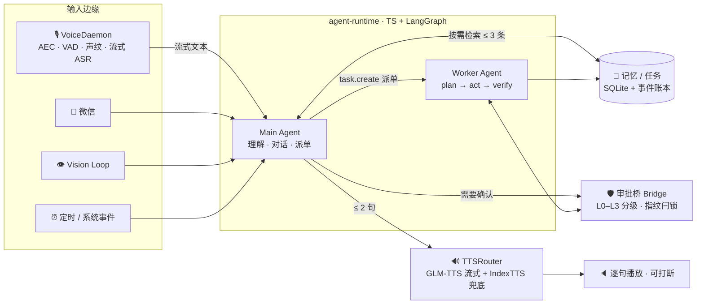

<div align="center">


<br/>


**思绪**不是聊天框。它常驻在你家电脑上：走过去就能说话，随时能被打断，
说话算话（"已完成"必须有证据），记得住事，还知道你在打游戏时该保持安静。

[架构](#%EF%B8%8F-系统架构) · [安全设计](#%EF%B8%8F-安全不是提示词) · [实测数据](#-实测数据) · [快速开始](#-快速开始)

</div>

## ✨ 这是什么

一个从零自研的家用语音管家 Agent：Windows 原生 Python 语音 frontline + TypeScript/LangGraph 模块化大脑，
一个月内从第一次提交走到全链路切换自研运行时（[152 次提交](../../commits)）。

- 🎙️ **随叫随到** —— 麦克风 48k 采集 → AEC 回声消除 → Silero VAD → CAM++/ERes2NetV2 声纹放行 →
  sherpa-onnx 流式 zipformer 中文 ASR；桌前 1–2 米随口说，目标 2 秒内开口，10 次成 9 次
- ✋ **随时打断（barge-in）** —— 它正在说话时你一开口：清播放队列、停合成、abort 上游请求，0.5 秒内闭嘴
- 🧠 **模块化大脑** —— Main/Worker 双 Agent 按角色编译 prompt：每轮固定 token 从 16,667 砍到约 451（**-97%**）
- 🛡️ **权限不靠自觉** —— L0–L3 能力分级 × 角色矩阵 × 审批闩锁；生物特征只认身份，永不提权
- ✅ **说话算话** —— "已完成"必须由 Result Verifier 的外部效果证据确认（进程+窗口、文件哈希、渠道回执），
  模型的自我汇报不算数
- 🧵 **任务是一等公民** —— `plan → act → verify → outcome` 状态机，可查询、可取消、断电后如实转 `interrupted`，不伪装继续运行
- 🌙 **记忆会睡觉** —— 长期记忆只能走"证据 → 候选 → 审核 → 提交"安全链；夜间固化、排练、分层写入，模型无写权限
- 🌱 **主动有分寸** —— 从记忆里长出来的主动行为必须先经一次口头确认；游戏态/深夜不开口，开口前一声短提示
- 🎮 **游戏模式** —— F9 一键全听 + 截屏攻略助手，模型按需升档，付费模型日耗熔断

## 🎙️ 一句话的旅程

```text
 说话 ─▶ 采集 48k ─▶ AEC ─▶ VAD ─▶ 声纹放行 ─▶ 流式 ASR ─▶ 大脑 ─▶ 按句 TTS ─▶ 逐句播放
             ▲            电视 / 访客 ──✕── 不触发、不进会话              │
             │                                                            │
             └──────── 你一开口：0.5s 内 清队列 · 停播放 · abort 请求 ◀─────┘
```

- 回复默认 ≤ 2 句；内容更长就先给两句要点，再问"要我展开讲吗"
- 未注册声音（电视、访客）不触发；声纹只作身份信号，不作为授权
- 同音错字按最合理的意思理解；工具结果消化成一句口语结论，不念错误码

## 🏗️ 系统架构



所有输入（语音 / 微信 / 摄像头 / 系统事件 / 定时器）先归一为统一事件，再进入核心；
主线 Agent 只负责理解与交流，慢活全部派给拥有独立生命周期的 Worker；
权限最终由代码拦截，而不是靠提示词请求模型自律。

<details>
<summary>🔌 生产运行拓扑（端口与守护）</summary>

```text
VoiceDaemon（schtasks GuanjiaVoice，控制口 :18795）
  ├─ 大脑    http://127.0.0.1:18800/v1/chat/completions   agent-runtime（TS，Fastify）
  ├─ 审批    http://127.0.0.1:18801  /latest /decide      bridge（Bearer 同 token）
  └─ 任务    GUANJIA_WORKER_BACKEND=ts → /v1/worker/*     LangGraph plan→act→verify→outcome（SSE）
guard 守护：voice-supervisor.ps1 每 2s 探测 18800/18801，掉线自动拉起
TTS：GLM-TTS 流式主路（TTSRouter）· IndexTTS-2.5 WSL2 :18791 兜底 · IndexTTS 2.0 Windows :18790 备用
```

</details>

## 🧠 模块化大脑

旧链（OpenClaw + 一份大 AGENTS）每轮固定 prompt ≈ **16,667 token**，其中约 60% 都在给模型描述工具；
真正的人格、记忆只占零头。换代思路不是换更强的模型，而是换信息架构：

| | Main Agent（前台） | Worker Agent（干活） |
|---|---|---|
| 职责 | 理解、对话、派单、问确认 | 独立执行多步任务 |
| 工具 | 9 个高层快工具（极简） | 全套 30 工具 |
| 会话 | 与主人共处的语音轮 | 每任务独立会话 + SQLite checkpoint |
| 编排 | 直调快路，≤ 2 句出口 | LangGraph `plan → act → verify → outcome`，SSE 进度 |
| 预算 | 固定 ≈ 451 token | 任务契约 + TaskSpec，不共享聊天历史 |

- **Prompt Compiler**：系统提示词按角色分节编译（`platform-min / persona / voice-rules / context / memory`），
  每节有字符预算，改动被编译器测试锁定
- **按需记忆**：每轮检索 ≤ 3 条注入 MEMORY 段，检索失败/超时不阻断语音轮
- **可中断可复活**：审批中断 → 恢复、取消、checkpoint 复活都有专项测试
- **降级开关**：一条环境变量即可切回旧链（`GUANJIA_BRAIN_URL`），大脑故障有退路

## 🛡️ 安全不是提示词

家庭场景的底线：**模型可以说错话，但系统不能做错事。**

**1 · 身份 ≠ 授权。** 声纹/人脸只回答"这是谁"；能做什么由角色矩阵（`owner / trusted_family / visitor / self_loop`）
独立计算。未登记的能力一律拒绝（fail-closed）。

**2 · L0–L3 能力分级。** 每项能力只有一个声明来源（Python 侧 `capability_levels.py` 与 TS 侧 `capabilities.ts` 一致性受检）：

| 级别 | 语义 | 例子 |
|---|---|---|
| L0 | 只读，即做 | 查天气、看屏幕、读文件、记忆检索 |
| L1 | 本机可逆，按策略 | 启动应用、写文件、exec、TTS、任务管理 |
| L2 | 敏感能力 | terminal、secrets、gateway、插件 |
| L3 | 出机器 / 不可逆 | 发消息、上传 —— 必须先经一次口头确认 |

**3 · 审批闩锁绑定指纹。** confirmation 授权的是 `ActionRequest` 指纹（原会话 + 原工具 + 原参数），只允许一次；
主人说"允许"后由系统用完全相同的参数自动重试。没有东西拦截时，模型绝不能说"需要确认"或"被拦了"。

**4 · Result Verifier 说了算。** 安装成功 = 包管理器状态 + 可执行文件存在；打开成功 = 进程 + 可见窗口；
下载成功 = 文件大小/哈希；发消息成功 = 渠道回执。**exit code 0 只代表"命令已被接受"**，
没过 verifier 之前系统只能说"请求已发出"。

**5 · 隐私闸门。** 脱敏钩子 + 上云调用记录；本机 HTTP 客户端一律 `trust_env=False`（防代理劫持）；
模型红线：不外泄这个家的任何隐私。访客模式与记忆可见性分级内建。

## 🌙 记忆会睡觉

```text
原始证据 ─▶ 候选(MemoryProposal) ─▶ staging 暂存 ─▶ 人工/口头审核 ─▶ commit 提交 ─▶ 分层固化
                    ▲  模型只到这里，无 workspace 写权限
```

- **夜间固化**：sleep 模块在深夜做 staging / rehearsal / commit，带 watermark 与分层（layers）；
  白天 `context_gardener` 自动压缩上下文
- **冲突与置信度**：记忆条目带来源与 confidence，冲突有显式处理，事实可降级
- **主动的克制**：从记忆长出来的周期性事件先生成草案，**口头确认后才生效**；隐式信号只能收紧、不能放宽（D15）；
  游戏进程白名单（D26）与深夜静默兜底；家人独自在家超过一小时，它可能会搭句话——但先出一声短提示

## 🎮 游戏模式 & 👁️ 视觉

- **游戏模式**：F9 全局热键一键切换；保留麦克风"全听" + `screen_capture` 截屏问攻略；
  模型自动升档到完整版，配合**付费模型日耗熔断**防止烧光余额；托盘右键常备逃生口
- **视觉循环**：动静门控 + VLM 仲裁压误检、周期按需重锚、单轴分步转向、无人回中、回看护位——
  镜头不再对着墙发呆

## 📊 实测数据

| 指标 | 旧链（OpenClaw） | 新链（agent-runtime） |
|---|---|---|
| 每轮固定 prompt | ≈ 16,667 token | **≈ 451 token（-97%）** |
| 纯聊天首字延迟 | —（上游 402，跑不完一轮） | **≈ 1.2 s**（流式直连） |
| 带工具全链 | 同构 | ≈ 13.7 s（含模型思考 + 外呼 + 二轮生成） |
| 打断 → 停 | 目标 ≤ 0.5 s | **≤ 0.5 s**（验收 10 次成 9 次） |
| 说完 → 回应 | 目标 ≤ 2 s | **≤ 2 s**（1–2 米，验收 10 次成 9 次） |
| TTS RTF | IndexTTS-2.5：0.69–0.80 | GLM-TTS 流式为主路，IndexTTS 兜底 |

**测试基线**：TS 侧 vitest 69 测（contracts / registry / main-agent / server / worker / prompts）+ `tsc` 零错误；
Python 侧 pytest 套件（bridge 73 测、worker 后端 13 测、记忆 15 测等）；
改动后的标准验证协议 `scripts/verify_chain.py` 四点全检。

## 🚀 快速开始

> 本项目为家庭自用部署（Windows 10/11 + WSL2），暂时没有通用的"一键安装"。
> 以下是最短可用路径，常驻与排障细节见折叠块。

**0. 前置**：Windows 10/11 · Python 3.12 + [uv](https://docs.astral.sh/uv/) · Node ≥ 22 ·
麦克风/音箱（无需额外买设备）

```powershell
# 1. 安装依赖
git clone https://github.com/inksnowhailong/Thoughts.git Thoughts && cd Thoughts
uv sync

# 2. 大脑（agent-runtime）
cd agent-runtime
npm ci
npm run build
copy config\runtime.example.json config\runtime.json   # 填入随机 token 与端口
copy config\models.example.json  config\models.json    # 填入模型与 API key
npm test                                                 # 69 测应全绿

# 3. 回到根目录，配置语音侧同一 token（GUANJIA_GATEWAY_TOKEN）

# 4. 下载 sherpa-onnx 模型到 models/（不入库）
#    流式 zipformer 中文 int8 · Silero VAD · CAM++ / ERes2NetV2 声纹

# 5. 注册主人声纹
uv run python -m guanjia.enroll --name 我 --seconds 12 --in 20

# 6. 启动三件套（或用 scripts/ 下计划任务 + voice-supervisor.ps1 守护）
node agent-runtime/dist/src/index.js        # 大脑 :18800
uv run python -m guanjia.bridge_service     # 审批桥 :18801
uv run python -m guanjia.voice --in 20 --out 16   # 语音守护进程（设备号用 --help 查看）
```

<details>
<summary>🔊 TTS 部署细节（WSL2 IndexTTS-2.5 / Windows 2.0 备用 / GLM-TTS 主路）</summary>

- **GLM-TTS 流式主路**：`tts_router` 优先走云端流式（音色 douji），SSE base64 解码
- **IndexTTS-2.5（WSL2 兜底）**：WSL2 Ubuntu `~/index-tts`，uv venv，权重 `checkpoints_25`，
  服务脚本 `~/guanjia-tts/tts_server.py`，端口 18791，RTF 0.69–0.80；
  由 Windows 计划任务 `GuanjiaTTS-WSL` 前台挂住 wsl.exe（WSL 后台进程会随 SSH 会话消失）

| 环境变量（`~/guanjia-tts/env`） | 取值 |
|---|---|
| GUANJIA_TTS_VERSION | `2.5` |
| GUANJIA_TTS_MODEL_DIR | `checkpoints_25` |
| GUANJIA_TTS_COMPILE | `0` / `1`（torch.compile） |
| GUANJIA_TTS_PORT | `18791` |
| GUANJIA_TTS_REF | 参考音色 wav 路径（换音色只换 `tts_server/voices/ref.wav`） |

- **IndexTTS 2.0（Windows 备用）**：`F:\coding\index-tts`，计划任务 `GuanjiaTTS`，端口 18790，加载约 5 分钟
- 切换：`GUANJIA_TTS_URL` 指向 18791 或 18790

```powershell
schtasks /Run /TN GuanjiaTTS-WSL        # 启动 WSL 2.5
schtasks /Run /TN GuanjiaTTS            # 启动 Windows 2.0
```

</details>

<details>
<summary>⚠️ 已知约束</summary>

- 音频必须跑在桌面会话里；SSH 会话拿不到设备（远程排障用 `schtasks /IT` 前台挂住）
- WASAPI 共享模式只接受设备原生采样率：链路 48k 采集、16k 识别
- 回答默认 ≤ 2 句，由 Main 角色 `voice-rules` 约束
- 本机 HTTP 客户端一律 `trust_env=False`，否则会被 Clash 代理劫持成 502
- 模型配置文件（`models.json` / `runtime.json`）含密钥，不入库——仓库内只有 `.example`

</details>

## 📁 仓库导览

```text
src/guanjia/                  Python 语音 frontline 与领域核心（Windows 原生）
  voice.py                      语音守护进程：采集→AEC→VAD→声纹→流式 ASR→TTS→播放；打断
  core/                         任务状态机、事件账本、调度器、模型策略
  bridge/                       审批桥：能力分级、审批闩锁、凭证、审计
  permission/                   角色矩阵、授权、确认流、agent 门禁
  memory/                       记忆仓库：证据链、冲突、维护
  sleep/                        夜间记忆固化：staging/rehearsal/committer/分层
  proactive/                    主动行为：习惯、时间线、触发器、隐私
  self_loop/                    自省闭环：采集、压缩、编排、可视化
  input/ output/                统一事件输入与输出代理（语音/微信/面板/静默日志）
  panel.py · panel.html         Web 工作台：架构面板、prompt 抽屉、记忆页
  vision_loop.py                摄像头视觉循环（门控/VLM 仲裁/重锚/转向）
agent-runtime/                TypeScript 大脑（LangGraph Main/Worker + Fastify + SQLite）
contracts/                    跨语言契约：事件、任务、审批、记忆的 schema 与 fixtures
tts_server/                   IndexTTS 合成服务与参考音色
scripts/                      启动脚本、守护、冒烟测试、基准、验证协议
docs/                         spec、宏架构设计、各阶段计划与验收报告
```

## 🗺️ 路线图

- ✅ **S1 听与说** —— 声纹放行、流式 ASR、逐句 TTS、0.5s 打断
- ✅ **S2 记事与做事** —— 到点提醒、找片开游戏（L1 直做）
- ✅ **S3 做事与安全** —— L0–L3 分级、确认通道、隐私闸门、微信桥
- ✅ **大脑换代** —— OpenClaw 退役，自研 agent-runtime 全量切换（Phase 7 验收）
- 🚧 **宏架构深化** —— Capability Registry 全量生成工具/策略/审计、统一事件模型全链贯通
- 📋 **语音复核** —— Qwen3-ASR 异步整句复核（WSL2 + vLLM）
- 📋 **评测与数据** —— 长期任务成功率看板（bridge audit + tasks 账本已可查）

## 📚 设计文档

| 文档 | 内容 |
|---|---|
| [docs/spec.md](docs/spec.md) | v2 规格：能力线、验收标准、技术选型与兜底 |
| [docs/plans/2026-10-15-macro-architecture-design.md](docs/plans/2026-10-15-macro-architecture-design.md) | 宏架构研究：六条横向契约、目标形态 |
| [docs/plans/2026-11-05-agent-runtime-phase7-report.md](docs/plans/2026-11-05-agent-runtime-phase7-report.md) | OpenClaw 退役切换的验收数据 |
| [docs/plans/2026-10-13-memory-design.md](docs/plans/2026-10-13-memory-design.md) | 记忆系统设计 |
| [docs/plans/2026-10-10-perm-v2-plan.md](docs/plans/2026-10-10-perm-v2-plan.md) | 权限 v2 方案 |
| [docs/HANDOFF.md](docs/HANDOFF.md) | 交接文档（当前状态与待办） |

## 🙏 致谢

- [sherpa-onnx](https://github.com/k2-fsa/sherpa-onnx) —— 流式 ASR / Silero VAD / 声纹模型运行时
- [IndexTTS](https://github.com/index-tts/index-tts) —— 高质量本地 TTS
- [LangGraph](https://github.com/langchain-ai/langgraph) · [Fastify](https://www.fastify.io/) · [better-sqlite3](https://github.com/WiseLibs/better-sqlite3) —— Worker 编排与服务底座
- [3D-Speaker](https://github.com/modelscope/3D-Speaker)（CAM++ / ERes2NetV2）—— 声纹识别
- [uv](https://docs.astral.sh/uv/) —— Python 环境管理
- 智谱 GLM · 硅基流动 —— 模型与推理服务

<div align="center">
<sub>© 2026 inksnow · 思绪，为家里而生 🏠</sub>
</div>
