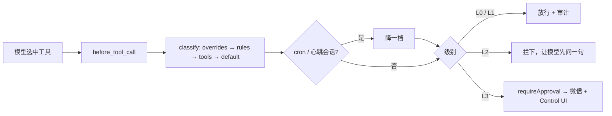
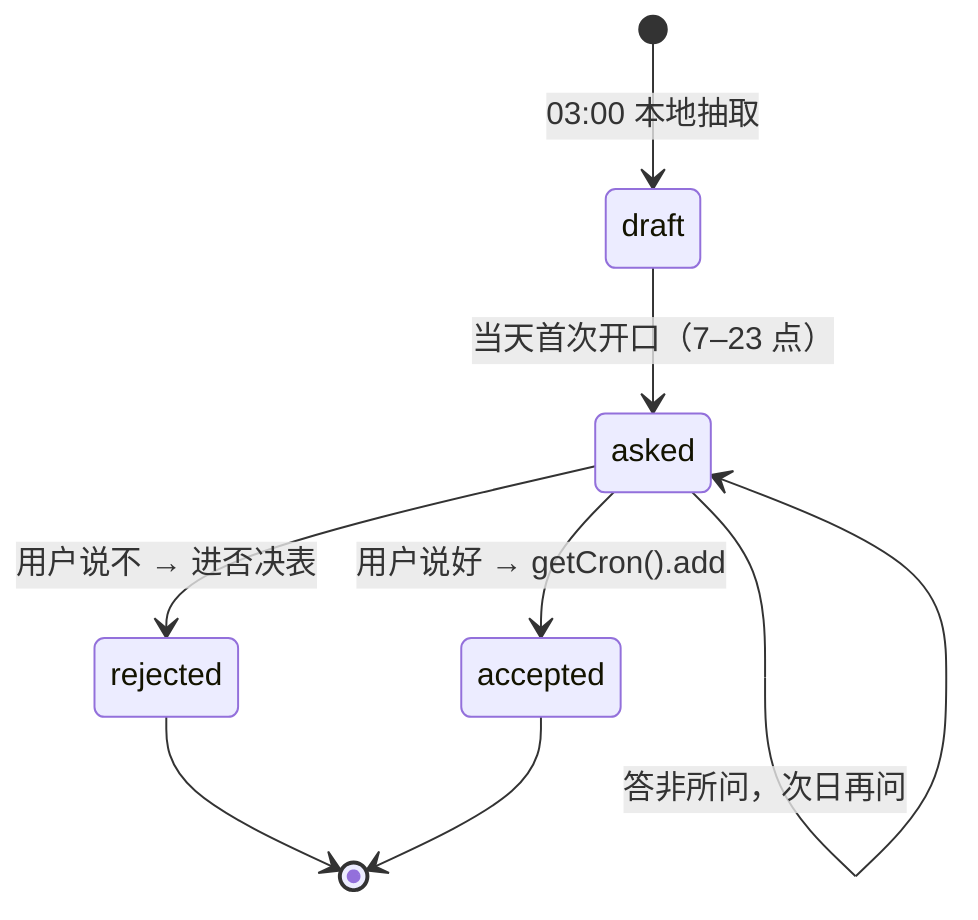

# S3 设计：分级中间层 · 脱敏闸门 · 主动侧窄版

> 2026-09-30。依据 OpenClaw 2026.9.6 自带文档（`node_modules/openclaw/docs`）与类型定义（`dist/plugin-entry-*.d.ts`）调研。
> 对应架构决策：D6、D8、D15、D18、6b。代码在 `plugins/guanjia-guard/`。

## 1. 结论一览

| 能力 | 用哪个挂钩点 | 能否做到 | 兜底 / 说明 |
|---|---|---|---|
| 工具调用前分级拦截（D6） | 插件 typed hook `before_tool_call` | 能 | 返回 `block` / `requireApproval`；超时或抛错时宿主默认 fail-closed |
| L2 回话确认 | `before_tool_call` 拦下 + `before_prompt_build` 读下一句用户话 | 能 | 插件自管"待确认动作"，同参数重试只放行一次，3 分钟过期 |
| L3 手机 + 桌面带外确认 | `requireApproval` + 配置 `approvals.plugin` 路由到微信 | 能（待装机验证） | 微信插件 2.4.8 无交互按钮，走纯文本 `/approve <id> allow-once`；Control UI 即桌面审批面 |
| 主动发起降一档 | `before_prompt_build` 的 `ctx.trigger` 登记 runId → `before_tool_call` 查 | 能 | 工具钩子上下文没有 trigger/jobId，只能按 runId 关联；另以会话 key 含 `:cron:` 兜底 |
| D8 规则提权带作用域和有效期 | `levels.json` 的 `overrides`（`scope` + 必填 `expiresAt`） | 能 | 生效与否记 audit.jsonl；"记时间线"因时间线归 S2 所有，暂记 audit，待 S2 定写入口 |
| 出门前改写模型请求（D18） | **钩子层做不到** | 用本地代理做到 | 见第 3 节 |
| 回包后回填 | 同上，代理里处理 JSON 与 SSE 流 | 能 | 占位符被切在两个流分片之间时留尾巴缓冲 |
| 每次上云记一条（不含原文） | 代理每次转发写 `audit.jsonl` | 能 | 只记模型、流式、各类实体替换次数、字节数 |
| 夜间抽周期性事件 → 草案 | command 型 cron（03:00）跑本地脚本 | 能，但**不用模型** | D18 规定时间线原文永不出门，而模型在云上；改为本地统计规则，见第 4 节 |
| 次日首次开口问一句 / 说好建 cron / 说不进否决表 | `before_prompt_build` 的 `appendContext` + 服务上下文 `getCron().add` | 能 | 深夜（23:00–07:00）不问；答非所问不纠缠，次日再问 |
| 天气雨雪骨架 | command 型 cron（06:30）跑脚本 | 能 | 没有 `GUANJIA_WEATHER_API_KEY` 就跳过并记审计 |

## 2. 分级中间层



这张图说的是一次工具调用从定级到处置的路径。

- **分级表**：`workspace/guanjia/levels.json`，用户可直接编辑，每次调用现读。首次启动从插件 `defaults/` 复制。
- **与 S2 对齐**：S2 的启动器命令 `launch-app.ps1 -Name <键>`、`automations` 提醒工具、工作区内 `write/edit`（含 `memory/timeline.md`）、`browser` 找片都是 L1。
- **自我保护**：模型改 `guanjia/` 下的文件（分级表、家庭事实、审计）一律 L3，防止模型给自己提权。
- **exec 的唯一闸门**：S2 准备的宿主 exec 白名单（`exec-approvals.json`）因权限未能写入，宿主 exec 目前是默认放开。所以 exec 以本插件为准，默认级别定为 L3：只有 S2 启动器命令是 L1，无拼接的只读查询是 L0，其余一律走手机审批。这样不会一句语音"确认"就执行任意命令。两边约定不再各自设置 exec 审批。以后如果宿主白名单写入，两层叠加，插件不能越过宿主授权。
- **L2 在主动会话里**：没人能当场确认，直接拦并告诉模型不要重试。
- **钩子失败**：`before_tool_call` 默认 15 秒超时，超时或抛错按宿主规则 fail-closed（拦下）。

## 3. 脱敏闸门：为什么是本地代理

逐个排查过的挂钩点：

| 候选 | 结论 |
|---|---|
| `llm_input` | 只能观察，返回值被忽略 |
| `before_agent_run` | 只能 pass / block，不能改写 |
| `before_prompt_build` | 能加上下文、能换系统提示词，但改不了历史消息和工作区注入文件里的实体 |
| contextEngine 槽位（lossless-claw 的做法） | `assemble()` 能重排消息，但系统提示词只能追加不能改；且要独占槽位 |
| provider 的 `wrapStreamFn` | 能改请求体，但只对插件**自己注册**的 provider 生效，包不住现有的 siliconflow |
| `message_sending` / `reply_payload_sending` | 只改最终出站回复，改不了发给模型的内容 |

所以改在网络层：插件在网关进程里注册一个服务，起 `127.0.0.1:18797` 代理，把 `models.providers.siliconflow.baseUrl` 指过来。

```
网关 ──> 127.0.0.1:18797 ──(实体→[[人名1]])──> api.siliconflow.cn
网关 <── 127.0.0.1:18797 <──([[人名1]]→实体)── JSON / SSE 回包
```

- **占位符稳定**：按 `family-facts.json` 里的登记顺序编号，同一实体多轮对话里永远是同一个占位符，模型前后能对上。
- **覆盖面**：请求体里所有自由文本都过一遍（系统提示词、历史、工具定义描述、历史工具参数）；协议字段（model、role、name、id 等）不动。
- **工具参数**：回包里的工具参数是 JSON 文本，回填时用 JSON 转义后的写法，路径里的反斜杠不会破坏参数。
- **流式**：`[[人` + `名1]]` 这类跨分片的占位符，先留在缓冲里，凑齐再放出。
- **失败策略**：请求体不是合法 JSON 时拒绝转发（宁可失败也不放原文出门）。
- **鉴权**：代理原样转发网关带来的 Authorization 头，不读取、不保存密钥。
- **代价与风险**：多一跳本机转发，延迟可忽略；代理依附网关进程，插件被禁用时必须先把 baseUrl 改回，否则所有模型调用失败。安装脚本的 `--redact` 会先确认端口在监听才切换，`--rollback` 负责改回。
- **不覆盖**：embedding（`memory.search.remote.baseUrl`）另走一条路，没有经过代理；原始音频本来就只在本机。

## 4. 主动侧窄版



这张图说的是一条习惯草案从产生到生效或被否决的状态。

- **抽取规则**：读 S2 的 `memory/timeline.md`（也兼容 JSONL），最近 6 周里同一星期几、同一小时、同一件事出现在不少于 3 个不同的周，就成为候选。提醒类取"提醒时刻"，记事类取"记录时刻"，取消类跳过。
- **文本清洗**：去掉"记一下 / 明天 / 下午三点"这类指令词和时间词，"记一下明天晚上八点交房租" → "交房租"。
- **偏离派活的地方**：派活要求"让模型抽"。但 D18 规定时间线原文永不出门，而当前模型在云上。所以改为本地规则，不经模型。以后如果接入本地模型，可以在脚本里替换抽取函数。
- **D15 非对称学习**：草案只产生、不生效；只有用户口头说好才建 cron；说不就永久进否决表，夜间脚本和发问都会跳过。
- **建出来的 cron**：会话 `main`，系统事件文本 `[guanjia:habit-reminder] 到点提醒用户：…`，与 S2 提醒的投递方式一致（出声由 S1 负责）。
- **天气**：`weather-check.mjs` 默认接和风天气 3 日预报，URL 可换；结果写 `workspace/guanjia/weather.json`。本切片不负责播报。

## 5. 文件与状态

```
plugins/guanjia-guard/
├─ index.ts              入口：注册钩子与服务
├─ src/levels.ts         纯函数定级（含 D8 覆盖、降档）
├─ src/guard.ts          before_tool_call 处置 + L2 待确认
├─ src/redact.ts         脱敏器 + 本地代理（JSON / SSE）
├─ src/habits.ts         习惯草案发问 / 确认 / 否决
├─ src/store.ts          workspace/guanjia 读写与审计
├─ scripts/habit-extract.mjs   03:00 command cron
├─ scripts/weather-check.mjs   06:30 command cron
└─ defaults/             levels.json、family-facts.json 模板
workspace/guanjia/       levels.json · family-facts.json · habit-drafts.json · weather.json · audit.jsonl
```

## 6. 已知限制

- 工具钩子拿不到 cron 的 jobId，主动发起的判定依赖同一 runId 先经过 `before_prompt_build`。command 型 cron 不经过模型，不受影响。
- L2 确认靠正则识别"确认 / 好 / 可以"，语音识别误差由 S1 负责；确认只对完全相同的参数生效。
- 微信插件 2.4.8 的主动推送依赖其 context token，用户长时间没和机器人说话时推送可能失败；此时审批仍可在 Control UI 完成，超时一律拒绝。
- `family-facts.json` 的 people / rooms 目前为空，需要用户按家里实际情况登记；已预填主机名、用户目录、项目路径、内网与 Tailscale IP。
